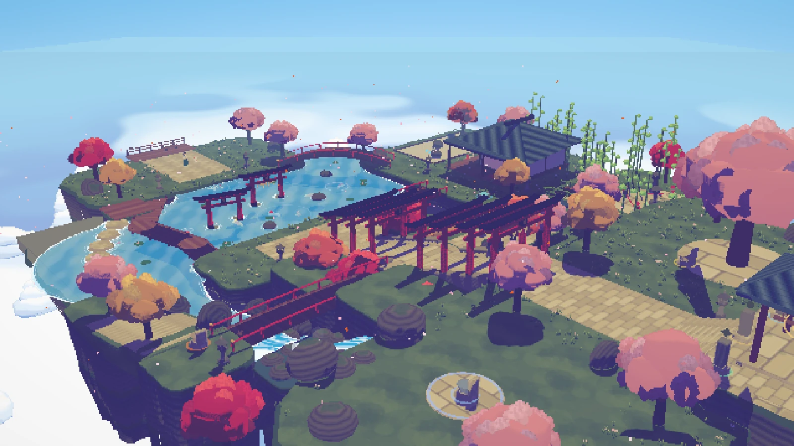
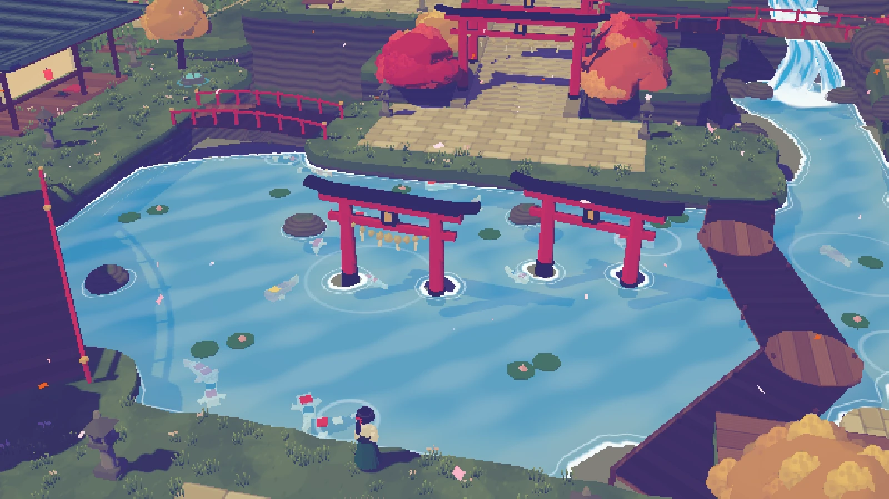
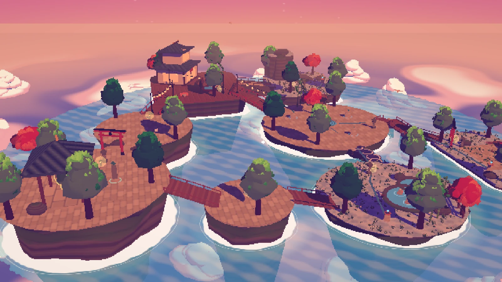
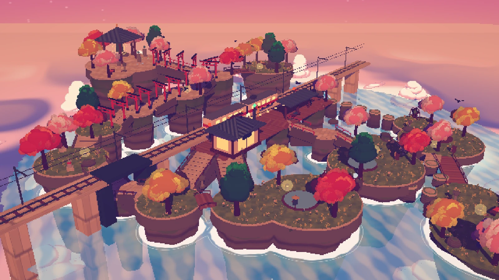
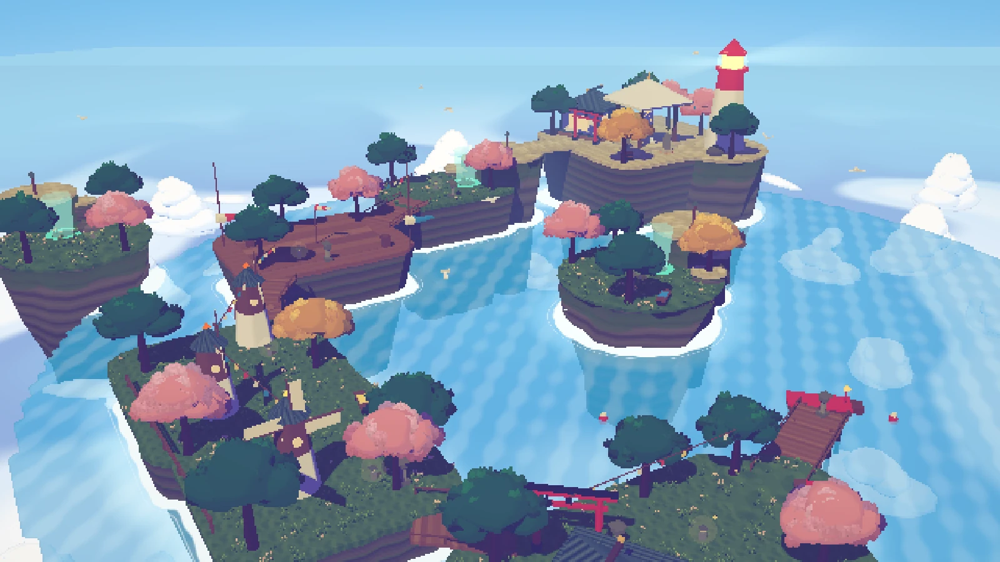
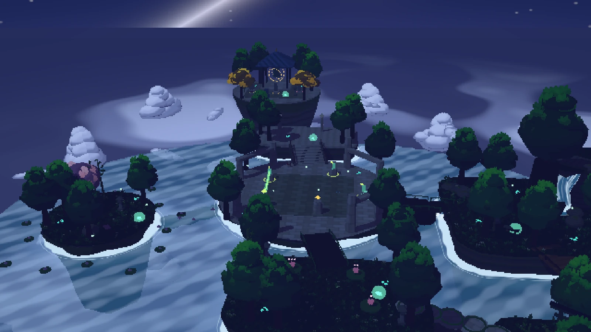
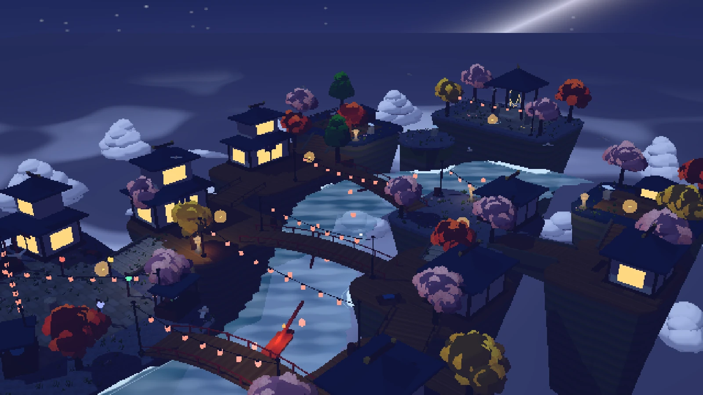
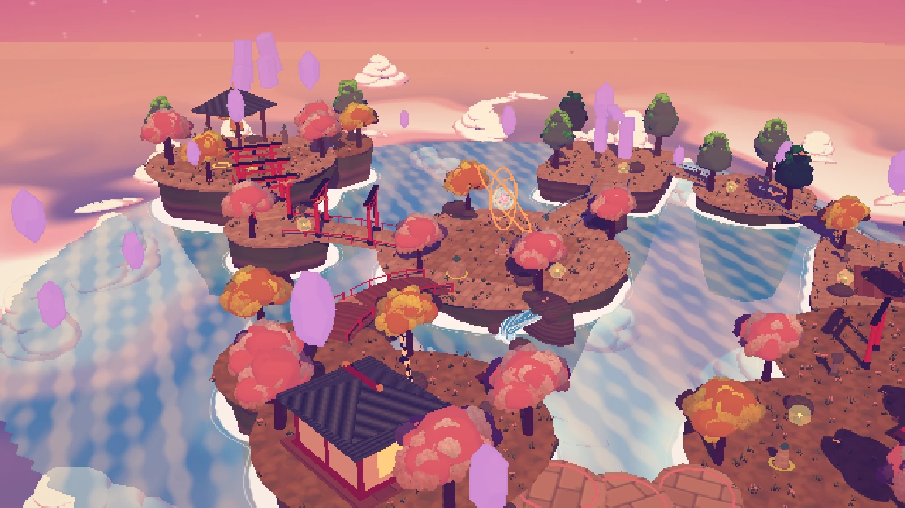

<div align="center">

# Kumo no Niwa · 雲の庭

**A garden above the clouds.**

A quiet 3D puzzle-exploration game about a girl, her calico cat and seven floating sanctuaries.
Built from scratch with Three.js and the Web Audio API, and it runs in the browser.



</div>

## About

High above a sea of clouds, the great temple bells have fallen silent. **Hana** and her calico cat **Mochi** travel through seven floating islands, waking three seals on each one so that every *Bonshō* can ring again.

The sky is your main tool. Shifting between **Day**, **Dusk** and **Night** changes the world itself: bridges appear only at a certain hour, rice paddies mirror the sky, steam vents wake after dark, and old ruins and living shrines trade places. No combat and no timers, just puzzles to read and a garden to wander.



## Features

- **Seven handcrafted sanctuaries** with 21 seal puzzles, unlocked one chapter at a time and closed by an ending cinematic.
- **Time of day as a mechanic.** Every chapter has its own rules for what changes between day, dusk and night.
- **Mochi, a real companion.** She follows you, leaps after you, grooms, naps beside you when you rest, purrs when you pet her and helps solve a few puzzles.
- **Procedural character animation.** Hana's hakama is a Verlet cloth that collides with her legs, and her ponytail, sleeves and hair react to every step and jump.
- **Pixel-art renderer.** The scene is rendered at 360 lines with sub-texel camera snapping so edges never shimmer. There is also a chunkier *Retro 250p* mode and a smooth *Painted HD* mode.
- **Layered sound.** Ambience comes from field recordings that cross-fade with the hour. Footsteps change with the surface underfoot, and instruments are synthesized live with Web Audio.
- **Poetic hints.** Press `H` for a nudge that never spoils the answer.

## The seven sanctuaries

| | Chapter | Biome | Seals |
| :-- | :-- | :-- | :-- |
| I | 雲上の湖 **Lake of the Sleeping Echo** | Koi lake, tea pavilion and cloud sakura | 水 Water · 竹 Bamboo · 月 Time |
| II | 杉の湯谷 **Cedar Onsen Valley** | Steaming mineral pools and cedar walkways | 湯 Spring · 霧 Steam · 猫 Hearth |
| III | 田園の駅 **Terrace Station** | Rural halt, mirror rice fields and Inari ridge | 鏡 Mirror · 灯 Signal · 風 Wind |
| IV | 風の岬 **Cape of Windmills** | Sea cliffs, white lighthouse and timber vanes | 翼 Vane · 凧 Kite · 空 Summit |
| V | 蛍の森 **Forest of Moss Lanterns** | Ancient cypress, sunken ruins and night streams | 蛍 Firefly · 蓮 Lotus · 影 Shadow |
| VI | 和紙の夜町 **Paper Town Rooftops** | Stepped alleys, blue tiles and canal locks | 鈴 Fūrin · 舟 Tōrō · 鶴 Crane |
| VII | 星の宮 **Crater of the Comet** | A golden shrine under two skies | 刻 Era · 星 Star · 響 Duet |

<table>
  <tr>
    <td></td>
    <td></td>
  </tr>
  <tr>
    <td align="center"><sub>II · Cedar Onsen Valley</sub></td>
    <td align="center"><sub>III · Terrace Station</sub></td>
  </tr>
  <tr>
    <td></td>
    <td></td>
  </tr>
  <tr>
    <td align="center"><sub>IV · Cape of Windmills</sub></td>
    <td align="center"><sub>V · Forest of Moss Lanterns</sub></td>
  </tr>
  <tr>
    <td></td>
    <td></td>
  </tr>
  <tr>
    <td align="center"><sub>VI · Paper Town Rooftops</sub></td>
    <td align="center"><sub>VII · Crater of the Comet</sub></td>
  </tr>
</table>

## Getting started

You need [Node.js](https://nodejs.org/) 18 or newer and a browser with WebGL2.

```bash
git clone https://github.com/NachoEstevo/Kumo-no-Niwa.git
cd Kumo-no-Niwa
npm install
npm run dev
```

Then open http://localhost:5173. Progress is saved in your browser's `localStorage`.

| Script | What it does |
| :-- | :-- |
| `npm run dev` | Starts the Vite dev server |
| `npm run build` | Builds a static site into `dist/` |
| `npm run preview` | Serves the production build locally |

The build is fully static, so `dist/` can be hosted on any static host.

## Controls

| Action | Input |
| :-- | :-- |
| Move | `WASD`, arrow keys, or click and drag on the ground |
| Run | Hold `Shift` |
| Jump | `Space` |
| Interact, push, ring a bell | `E` |
| Pet or call Mochi | `F` |
| Change the time of day | `T`, or the sky buttons in the top right |
| Rotate the camera | `Q` / `R` |
| Zoom | Mouse wheel |
| Diorama / panoramic camera | `C` |
| Hint | `H` |
| Mute | `M` |
| Menu, skip a cinematic | `Esc` |

## How it's built

There is no game engine, only [Three.js](https://threejs.org/) and [Vite](https://vite.dev/). Everything else lives in `src/`:

```
src/
├── main.js          Game loop, menus, chapter flow and progression
├── engine/          Pixel renderer, toon materials and painted textures
├── world/           Terrain, colliders, walkable surfaces, foliage and sky
├── entities/        Hana, Mochi and the koi
├── chapters/        Chapter catalog and the seven level definitions
├── systems/         Day cycle, puzzles, hints, tutorial and cinematics
└── audio/           Ambience mixer, sound effects and Web Audio synthesis
```

Some details:

- **Pixel rendering.** The scene renders to a low-resolution target that is upscaled with nearest-neighbour filtering. The orthographic camera snaps to the texel grid, and a post pass adds depth outlines.
- **Terrain as data.** Each level declares its terraces, bridges, stairs and colliders. Walking, standing and jumping query that data, so there is no physics engine. If the world changes under Hana's feet when the hour shifts, she is moved to the nearest safe spot.
- **Characters from code.** Hana and Mochi are built from parametric geometry (lofts, lathes and swept hair locks) and animated procedurally, with no imported models or skeletons.

## Credits

Created by **Ignacio Estevo**.

- Ambient soundscapes use CC0 field recordings.
- Sound effects are new takes of public-domain recordings, shaped with *earshot*.
- Music and instruments are synthesized in real time with the Web Audio API.
